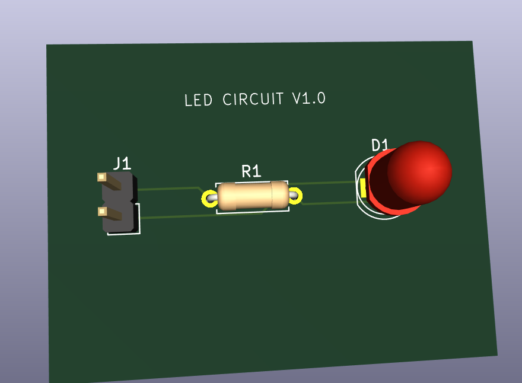
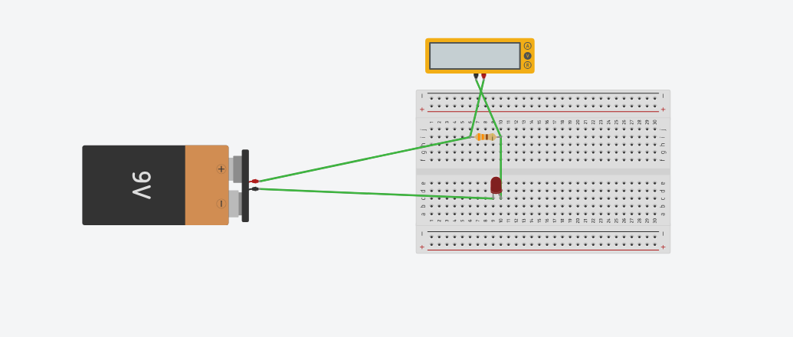
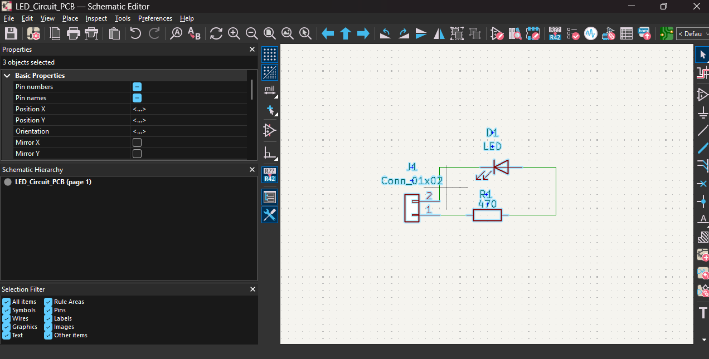
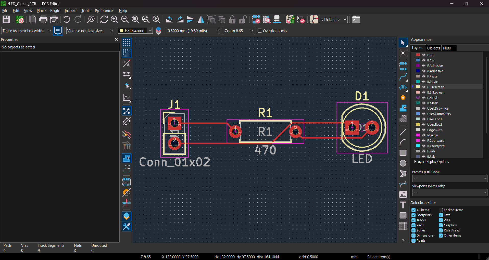
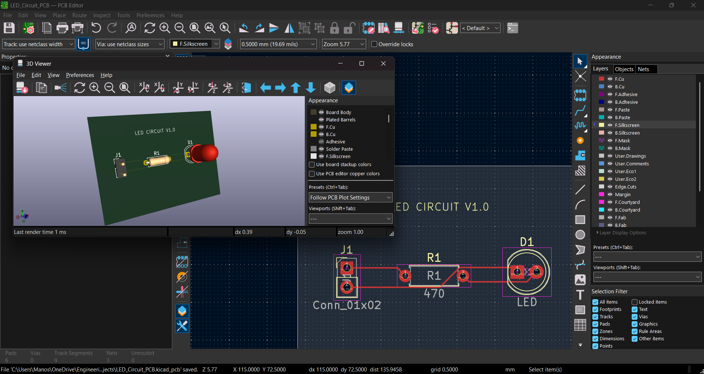

# LED Circuit PCB — First PCB Design



**My first virtual PCB design in KiCad 10**, built to learn the complete process from a simple LED circuit to an electrical schematic, component footprints, copper routing, design checks, and a 3D PCB model.

> **Project status:** Designed and checked virtually. The PCB has **not** been manufactured, assembled, or physically tested.

## Project at a glance

| Item | Details |
| --- | --- |
| Software | KiCad 10; Tinkercad Circuits |
| Circuit | 9 V LED circuit with series current-limiting resistor |
| Components | J1: 2-pin power header; R1: 470 Ω resistor; D1: 5 mm LED |
| PCB | Front-copper routing, rectangular board outline, top silkscreen |
| Verification | ERC, DRC, and schematic parity checks; reported zero errors |
| Assembly | Virtual 3D model only |

## How the circuit works

The 9 V input connects to an LED through a 470 Ω resistor. The resistor limits current through the LED. Assuming a red LED forward voltage of about 2 V, the estimated current is:

```text
I = (Vs - V_LED) / R
  = (9 V - 2 V) / 470 Ω
  ≈ 0.0149 A = 14.9 mA
```

This is a **theoretical estimate**. Actual current depends on the LED's characteristics, the supply, and real component tolerances.

## Design process

### 1. Explore the circuit in Tinkercad

I used Tinkercad to practice connecting a 9 V battery, resistor, and LED, and explored voltage measurements with the virtual multimeter. The initial simulated circuit was a learning exercise; the PCB schematic uses **470 Ω**.



### 2. Create the electrical schematic

I drew the power connector (J1), resistor (R1), and LED (D1) in KiCad's Schematic Editor and wired the circuit.



### 3. Choose footprints and route the PCB

I selected through-hole footprints, transferred the schematic to the PCB Editor, arranged the components, created the board outline on **Edge.Cuts**, and routed connections on **F.Cu**.



### 4. Run design checks

I practiced using KiCad's **Electrical Rules Checker (ERC)** and **Design Rules Checker (DRC)**. I also ran the schematic-to-PCB parity check. The checked design reported **0 errors** and **0 unrouted connections**.

These checks do not replace physical testing or guarantee that a manufactured circuit will work.

### 5. Inspect the board in 3D

I viewed the PCB in KiCad's 3D Viewer and added component references and the title **LED CIRCUIT V1.0** to the front silkscreen.



## What I learned

- The difference between a schematic symbol and a physical PCB footprint
- Selecting through-hole component footprints
- Organizing parts and routing front-copper traces
- Creating a PCB boundary with Edge.Cuts
- Understanding silkscreen and fabrication layers
- Checking designs with ERC, DRC, and schematic parity
- Documenting an engineering project with screenshots and source files

## Limitations and next steps

This is my **first virtual PCB design**, not a finished hardware product. To validate the design in the real world, the next steps would be to confirm component specifications and pin polarity, manufacture and assemble the board, and measure LED voltage and current.

Potential future improvements include clearer power-input polarity labels, a more compact PCB outline, and improved manufacturing documentation.

## Project files

The [images folder](images/) contains screenshots of the design process. The original, editable KiCad source files are available in this repository:

- [KiCad project settings](LED_Circuit_PCB.kicad_pro)
- [Electrical schematic](LED_Circuit_PCB.kicad_sch)
- [PCB layout](LED_Circuit_PCB.kicad_pcb)

Open the project file in KiCad 10 to inspect or modify the design.
